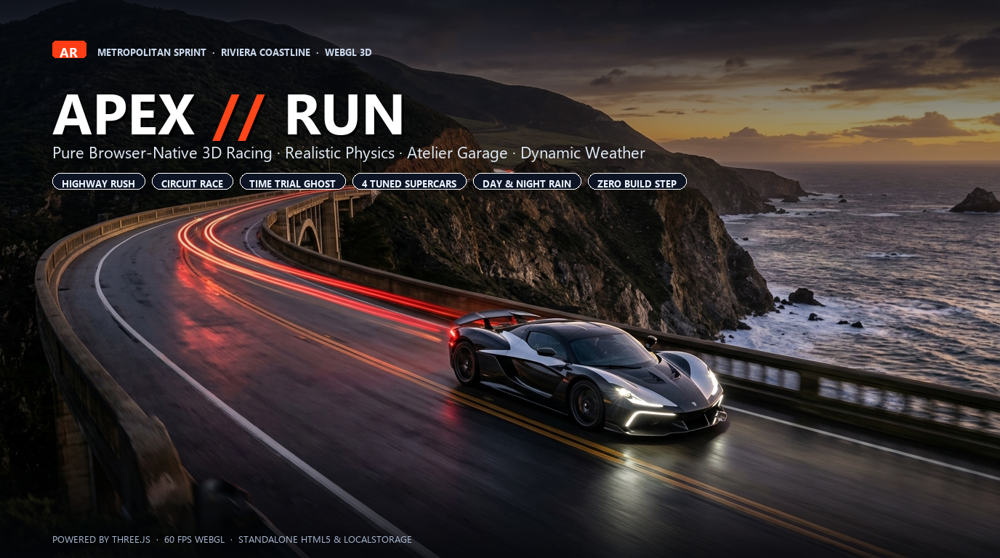

<p align="center">
  
</p>

<p align="center">
  <strong>High-performance, browser-native 3D racing and atmospheric driving simulation built on Three.js.</strong>
  <br>
  <em>Zero build step · Pure HTML5/WebGL · Realistic vehicle physics · Standalone offline play</em>
</p>

<p align="center">
  
  
  
  
  
</p>

---

## 🏁 Overview

**APEX//RUN** is an adrenaline-fueled 3D arcade and simulation driving experience engineered directly for the modern web browser. 

Weave through relentless rush-hour traffic on multi-lane metropolitan boulevards, push prototype hypercars to their limits against 5 AI competitors along the sun-drenched Riviera cliffs, or race against your own ghost car in precision Time Trials.

With zero npm dependencies, no bundling process, and no local server requirement, **APEX//RUN runs straight out of the box**—just open `index.html` in any modern desktop or mobile browser.

---

## ✨ Key Features

### 🕹️ 4 Distinct Game Modes
- **Highway Rush (Core Mode):** Endless oncoming traffic dodge on a high-density urban expressway. Chain near-misses to ramp up score multipliers, discharge nitro reserves, and survive accelerating traffic pace. One collision ends the run.
- **Circuit Race:** High-stakes 6-car competitive race around the coastal Riviera circuit against 5 adaptive AI drivers. Configure AI aggression across *Touring*, *Sport*, and *Expert* tiers.
- **Time Trial:** Pure lap-time attack against your own personal best ghost car with real-time sector split telemetry.
- **Free Drive:** Open cruising with ambient traffic along the seaside cliffs—no timers, no rivals, pure driving bliss.

### 🏎️ The Garage & Performance Atelier
- **4 Distinct Vehicles:**
  - `APEX Concept GT` — Flagship AWD hypercar (640+ HP)
  - `Aerion GT/01` — Lightweight, rear-wheel-drive track weapon
  - `Velaris R/8` — High-revving naturally aspirated grand tourer
  - `Nexo E/X` — Instant-torque electric prototype
- **8 Custom Paint Finishes:** Curated palette from *Obsidian Black* and *Velocity Red* to *Riviera Cyan* and *Solar Gold*.
- **3-Stage Performance Upgrades:** Tune **Power**, **Grip**, and **Brakes** in the Atelier. Upgrades dynamically adjust engine torque curves, tire friction coefficients, and deceleration forces in **every** mode.

### 🌦️ Atmospheric Engine & Lighting
- **3 Times of Day:** *Daylight*, *Golden Hour (Sunset)*, and *Midnight*.
- **Dynamic Weather:** *Clear Skies* or *Rain*. Wet asphalt applies realistic tire slip, increased braking distances, and spray effects.
- **Illumination:** Real-time projected vehicle headlights and emissive neon tail lamps for immersive night runs.

### 📸 Replay Suite & Photo Studio
- **Full Replay System:** Relive your latest Highway Rush run or Circuit race with timeline scrubbing, variable playback speed ($0.5\times$ to $2.0\times$), and cinematic camera cycling.
- **Photo Mode:** Full $360^\circ$ orbit camera, interactive focal zoom, exposure tuning, and instant one-click high-resolution PNG screenshot capture.

### 🔊 Layered Synthesized Acoustics
- Procedural audio engine synthesized through the **Web Audio API**:
  - Multi-harmonic engine pitch modulation responsive to RPM and load
  - Turbo blow-off valve acoustics
  - Dynamic tire squeal on drift/skid
  - High-speed aerodynamic wind rush

### 💾 Seamless Save System & Portability
- Automatic browser state persistence via `localStorage`.
- One-click **JSON Save Export & Import** for effortless backup and cross-device migration.
- Backwards-compatible save import for *Velocity Atelier (V2)* files with automatic best-score migration.

### 🧪 Automated Self-Verification
- Built-in test suite executing **36 automated logic assertions** on every boot (verifying physics constants, track geometry, progression rewards, and save serialization). View status inside the Driver Guide.

---

## 🎮 Controls

### Desktop Keyboard
| Action | Keybinding |
| :--- | :--- |
| **Accelerate / Throttle** | `W` or `↑ Up Arrow` |
| **Brake / Reverse** | `S` or `↓ Down Arrow` |
| **Steer Left / Right** | `A` / `D` or `←` / `→` |
| **Nitro Boost (Highway Rush)** | `Space` or `Shift` |
| **Boost (Circuit)** | `Shift` |
| **Handbrake / Drift (Circuit)** | `Space` |
| **Cycle Camera Angle** | `C` |
| **Recover / Reset Vehicle** | `R` *(Circuit only)* |
| **Pause Menu** | `Esc` or `P` |

### 🎮 Gamepad Support
- **Steering:** Left Thumbstick
- **Accelerate:** Right Trigger (`RT`)
- **Brake:** Left Trigger (`LT`)
- **Nitro / Boost:** `A` Button
- **Handbrake:** `X` Button
- **Camera:** `Y` Button
- **Pause:** `Start` Button

### 📱 Touch HUD
- On-screen touch overlay automatically displays on mobile and tablet devices (or force enabled via Settings):
  - Left / Right directional pads
  - Dedicated **GAS**, **BRAKE**, and **NITRO** touch buttons

### ⚡ Quick URL Launch Shortcuts
Append hash parameters to start directly into any mode:
- `index.html#rush` — Launch straight into Highway Rush
- `index.html#circuit` — Launch straight into Circuit Race
- `index.html#trial` — Launch straight into Time Trial
- `index.html#free` — Launch straight into Free Drive

---

## 🚀 Getting Started

No build scripts, no node_modules, and no compilers are required.

### 1. Instant Play (Offline / Standalone)
Simply double-click [`index.html`](index.html) in your file manager to play immediately in your browser (`file:///` protocol supported).

### 2. Local Web Server (Recommended)
If you prefer running through a local web server:

**Using Python:**
```bash
python -m http.server 8080
```
Open [http://localhost:8080](http://localhost:8080) in your browser.

**Using Node / npx:**
```bash
npx serve .
```

### 3. Deploy to GitHub Pages
1. Push this repository to GitHub.
2. In your repository, go to **Settings** → **Pages**.
3. Under **Build and deployment**, select **Deploy from a branch** → Branch: `main` / `root`.
4. Your game will be live worldwide at `https://<your-username>.github.io/CarRacing/`!

---

## 📂 Project Architecture

```
CarRacing/
├── assets/
│   ├── banner.png                     # Official game banner
│   ├── wallpaper.jpg                  # High-res cinematic hypercar artwork
│   ├── car.glb                        # 3D Concept GT hypercar model (GLTF binary)
│   ├── car-data.js                    # Embedded base64 vehicle asset payload
│   ├── scenery-data.js                # Embedded environment mesh assets
│   └── ASSET-CREDITS-POLYHAVEN.txt    # Mesh licensing attributions
├── css/
│   └── style.css                      # Modern glassmorphism UI & HUD stylesheet
├── js/
│   ├── core.js                        # Physics engine, track curves, race math, save profiles
│   ├── vehicles.js                    # Vehicle procedural rigs, AI controllers, traffic logic
│   ├── engine.js                      # Three.js WebGL renderer, showroom, rain particle fx
│   ├── stage-rush.js                  # Highway Rush procedural boulevard generator
│   ├── stage-circuit.js               # Riviera coastline circuit track & spline systems
│   ├── scenery.js                     # Procedural environment loader (villas, foliage)
│   ├── audio.js                       # Procedural Web Audio API sound synthesizer
│   ├── game.js                        # Session coordinator, UI events, replays, camera modes
│   └── tests.js                       # 36 self-executing unit & logic verification tests
├── vendor/
│   ├── three.min.js                   # Three.js 3D library (r160)
│   └── GLTFLoader.js                  # GLTF/GLB model loader
├── legacy/                            # Archive of previous builds and development backups
├── index.html                         # Main entrypoint & UI layout
└── README.md                          # Documentation
```

---

## 🛠️ Modding & Custom Vehicle Replacement

Want to substitute the default Concept GT with your own 3D model?

1. Place your `.glb` model into `assets/car.glb`.
2. Encode the `.glb` file to Base64 and assign it to `window.APEX_CAR_GLB_B64` inside `assets/car-data.js`.
3. Adjust wheel bone names and mesh materials in [`js/vehicles.js`](js/vehicles.js).

---

## 🏆 Credits & Attributions

- **Concept GT 3D Model:** Eric Chadwick / Darmstadt Graphics Group ([CC BY 4.0](https://creativecommons.org/licenses/by/4.0/)).
- **Environment Geometry:** Pine Sapling Small & Modular Urban Apartments Facade via [Poly Haven](https://polyhaven.com/) ([CC0](https://creativecommons.org/publicdomain/zero/1.0/)).
- **3D Graphics Engine:** [Three.js](https://threejs.org/) (MIT License).
- **Original Vehicles:** Aerion GT/01, Velaris R/8, and Nexo E/X are fictional designs created for APEX//RUN.
- **Audio:** Custom Web Audio API procedural synthesis.

---

## 📄 License

This project is licensed under the [MIT License](LICENSE) — feel free to explore, learn, mod, and build upon it!
